# Настройка платы

Плата хранит настройки у себя во флеше. Они переживают выключение и
обновление прошивки: блок настроек лежит выше образа и ниже банка, и ни
одна заливка его не трогает.

Задать их можно двумя способами, и оба равноправны:

- **с экрана Спектрума** - конфигуратор, встроенный в прошивку;
- **файлом на карте** - `set_config.txt` в корне.

Что бы вы ни выбрали, результат один: тот же блок во флеше.

## Конфигуратор на экране

Плата подставляет Спектруму собственное ПЗУ и показывает список настроек.
Клавиатура годится любая: подключённая к плате по USB или родная, от самой
машины.

### Как войти

| Способ | Когда годится |
|---|---|
| **`Win` + `F12`** на клавиатуре USB | клавиатура USB подключена к плате, и USB у платы включён (см. раздел "Клавиатура USB") |
| **Переключатель ZC/DIVMMC** в положении на землю | клавиатуры нет или она выключена настройкой |
| **Файл `open.gui`** в корне карты | то же, без паяльника |

Все три приводят к одному: плата перезагружается и поднимает конфигуратор
вместо обычного режима. Машина при этом тоже сбрасывается - иначе она
осталась бы со старым содержимым памяти.

Переключатель ZC/DIVMMC (на части плат - перемычка) в этой прошивке
дисковую систему не выбирает. Пока он стоит в положении на землю,
**каждая** загрузка попадает в конфигуратор; для обычной работы его надо
перевести в другое положение.

Файл `open.gui` пустой, содержимое не смотрится - важно само наличие.
Плата снимает его, когда вы выходите из конфигуратора по "сохранить" или
по "отмена". Простой сброс выходом не считается: файл остаётся, и
следующая загрузка снова попадёт в меню. Это сделано нарочно - машина, не
дошедшая до экрана, обязана попасть в него со второй попытки.

### Что на экране

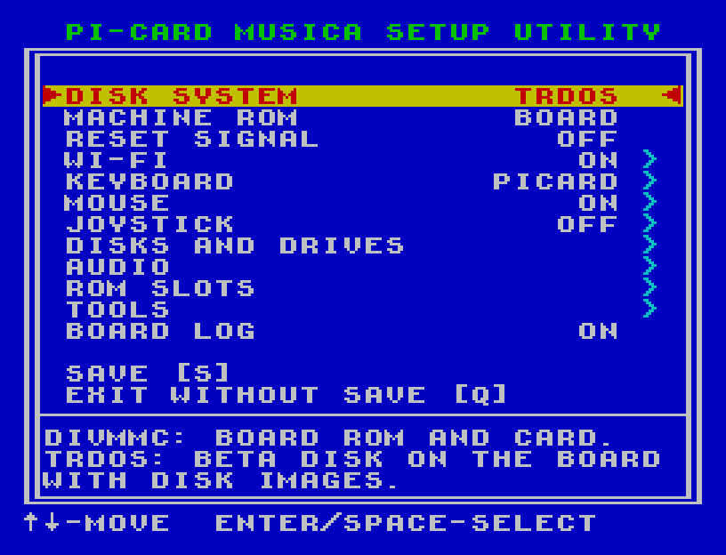

На главном экране - дисковая система, ПЗУ машины, сигнал сброса, журнал,
а также переходы в разделы. Пункт со знаком `>` справа открывает раздел;
если рядом стоит значение (`WI-FI ON >`), это включение устройства, а
остальные его настройки - внутри раздела. Последние два пункта - `SAVE
[S]` (сохранить) и `EXIT WITHOUT SAVE [Q]` (выйти, ничего не сохраняя).
Буква в скобках - то же самое одной клавишей, на любом экране со списком.

Внизу рамки - подсказка к пункту под курсором, под рамкой - какие
клавиши работают сейчас.

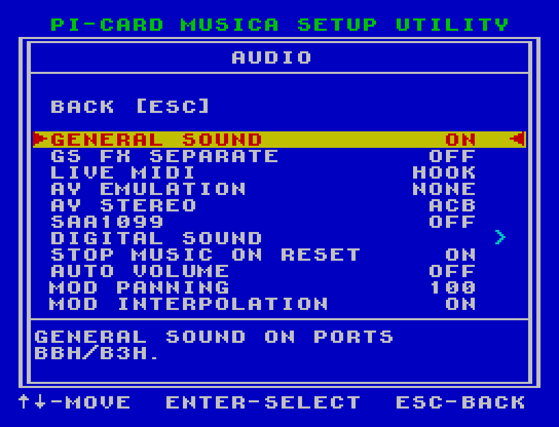

В разделе его имя стоит первой строкой. Вернуться на экран выше - пункт
`BACK [ESC]` в начале раздела, клавиша `ESC` или забой (`DEL`).

**Где какой параметр.** Пункты по порядку, в скобках - параметр файла
настроек (см. "Параметры" ниже).

| Экран | Пункты |
|---|---|
| главный | `DISK SYSTEM` (`DISKSYS`), `MACHINE ROM` (`ROM`), `RESET SIGNAL` (`RESET_SIGNAL`), `WI-FI >`, `KEYBOARD >`, `MOUSE >`, `JOYSTICK >`, `DISKS AND DRIVES >`, `AUDIO >`, `ROM SLOTS >`, `TOOLS >`, `BOARD LOG` (`LOG`), `SAVE [S]`, `EXIT WITHOUT SAVE [Q]` |
| `WI-FI` | `WI-FI` (`WIFI`), `NETWORK` (`WIFI_SSID`), `PASSWORD` (`WIFI_PASSWORD`) |
| `KEYBOARD` | `LAYOUT` (`KEYBOARD_LAYOUT`), `RIGHT SHIFT`, `LEFT CTRL`, `RIGHT CTRL`, `LEFT ALT`, `RIGHT ALT` (`MOD_*`), `JOYSTICK KEYS >` |
| `JOYSTICK KEYS (WIN+F2)` | `RIGHT`, `LEFT`, `DOWN`, `UP`, `FIRE`, `FIRE2`, `FIRE3`, `FIRE4` (`JOY_*`) |
| `MOUSE` | `USB MOUSE` (`USB_MOUSE`), `SPEED` (`MOUSE_SPEED`), `SWAP BUTTONS` (`MOUSE_SWAP_BUTTONS`), `AUTOSWAP` (`MOUSE_AUTOSWAP`) |
| `JOYSTICK` | `USB GAMEPAD` (`USB_GAMEPAD`), `8 BIT KEMPSTON` (`JOY_8BIT`) |
| `DISKS AND DRIVES` | `DIVMMC CARD 1` (`DIVMMC_CARD1`), `DIVMMC CARD 2` (`DIVMMC_CARD2`), `Z-CONTROLLER` (`ZCONTROLLER`), `SD CARD MHZ` (`SD_SPEED`) |
| `AUDIO` | `GENERAL SOUND` (`GS`), `GS FX SEPARATE` (`GS_FX_SEPARATE`), `LIVE MIDI` (`LIVE_MIDI`), `AY EMULATION` (`AY_EMULATION`), `AY STEREO` (`AY_STEREO`), `SAA1099` (`SAA1099`), `DIGITAL SOUND >`, `STOP MUSIC ON RESET` (`STOP_MUSIC_ON_RESET`), `AUTO VOLUME` (`AUTO_VOLUME`), `MOD PANNING` (`MOD_PANNING`), `MOD INTERPOLATION` (`MOD_INTERPOLATION`) |
| `DIGITAL SOUND` | `COVOX` (`COVOX`), `SOUNDRIVE` (`SOUNDRIVE`), `BEEPER` (`BEEPER`) |
| `ROM SLOTS` | `SLOT 1`, `SLOT 2`, `SLOT 3` (`ROM1_FILE`..`ROM3_FILE`) |
| `TOOLS` | см. "Инструменты" ниже |

Сброс машины кнопкой, пока открыт конфигуратор, из него не выводит:
экран появляется снова целиком, с тем же пунктом под курсором и с
несохранёнными изменениями.

**Цвета:**

| Вид | Значение |
|---|---|
| жёлтая полоса, красные буквы и стрелки по краям | пункт под курсором |
| жёлтое значение | изменено и ещё не сохранено |
| чёрные буквы | пункт недоступен при нынешних настройках |

### Клавиши

| Клавиша | Что делает |
|---|---|
| стрелки вверх, вниз | перейти по списку |
| `ENTER` или пробел | выбрать пункт |
| `ESC` или `DEL` | назад; в окне выбора и в окне числа - отмена; в окне строки `DEL` стирает знак; в таблице клавиш `DEL` очищает клавишу |
| `S` | сохранить и выйти в обычный режим |
| `Q` | выйти, ничего не сохраняя |

На клавиатуре Спектрума стрелки - `CAPS SHIFT` с `5`, `6`, `7`, `8`,
`ESC` - `CAPS SHIFT` и пробел, `DEL` - `CAPS SHIFT` и `0`.

Выход в обоих случаях - перезагрузка платы, после неё работают новые
настройки.

### Как меняются значения

**Включено или выключено** (`ON`, `OFF`) - `ENTER` переключает сразу.

**Несколько вариантов** - `ENTER` открывает окно со списком. Стрелками
выбрать, `ENTER` или пробел - принять, `ESC` или `DEL` - оставить как было.

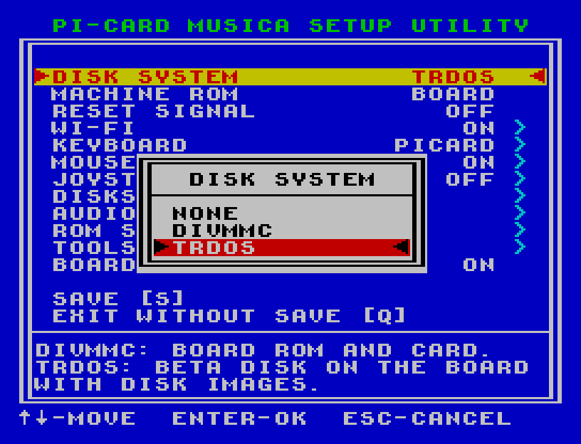

**Число** - окно со значением: стрелки влево и вправо меняют на 1,
вверх и вниз - на 10. `ENTER` - принять, `ESC` - отмена.

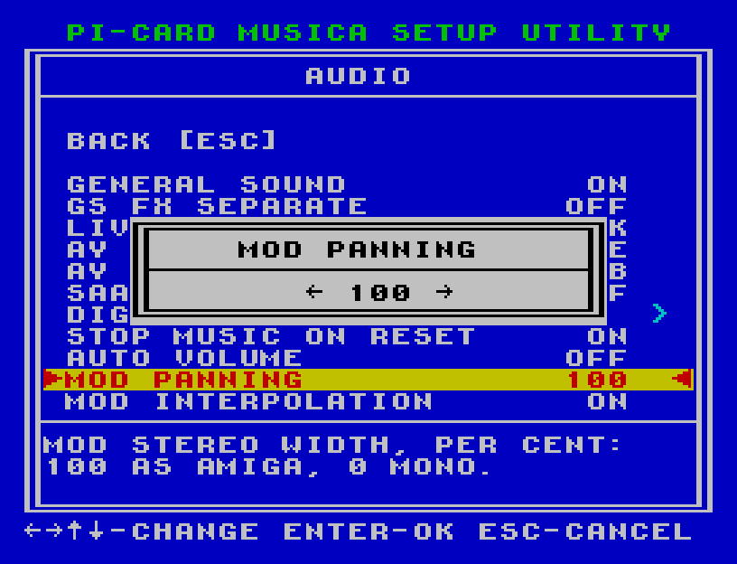

**Имя сети и пароль** - окно со строкой. `ENTER` - запомнить, `ESC` -
отмена, `DEL` - стереть знак.

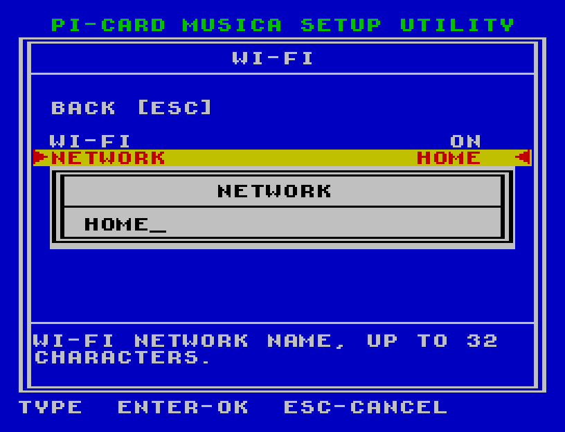

Строка набирается с любой клавиатуры. На клавиатуре Спектрума заглавные
буквы - с `CAPS SHIFT`, знаки - с `SYMBOL SHIFT`, как нарисовано на
клавишах: `@` - это `SYMBOL SHIFT` и `2`, `_` - `SYMBOL SHIFT` и `0`.
Пока строка набирается, она видна целиком, и пароль тоже; в списке
пароль показан звёздочками.

### Клавиши джойстика

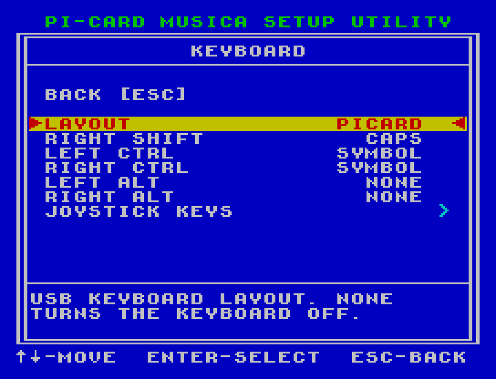

Раздел `KEYBOARD`, пункт `JOYSTICK KEYS`. У каждого действия две
клавиши: столбцы `KEY 1` и `KEY 2`.

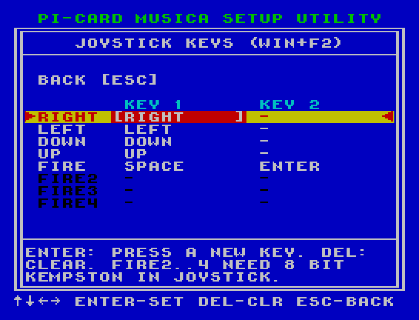

Стрелки вверх и вниз выбирают действие, влево и вправо - столбец.
Выбранная клавиша - в квадратных скобках. `ENTER` - нажмите нужную
клавишу на клавиатуре USB, `DEL` - убрать клавишу, `ESC` - назад.
`FIRE2`..`FIRE4` доступны при `8 BIT KEMPSTON` = `ON` в разделе
`JOYSTICK`.

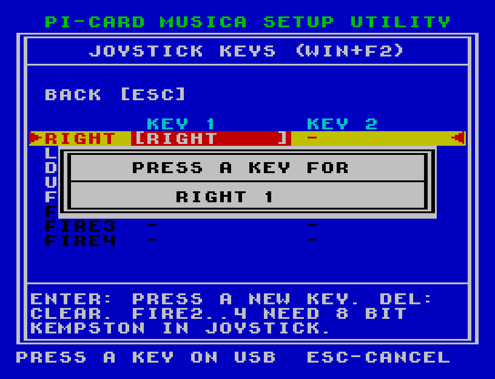

`ESC` или забой в окне ожидания - отмена; их самих назначить нельзя.

### Своё ПЗУ машины

В разделе `ROM SLOTS` три места для своих ПЗУ (образ ПЗУ Пентагона).

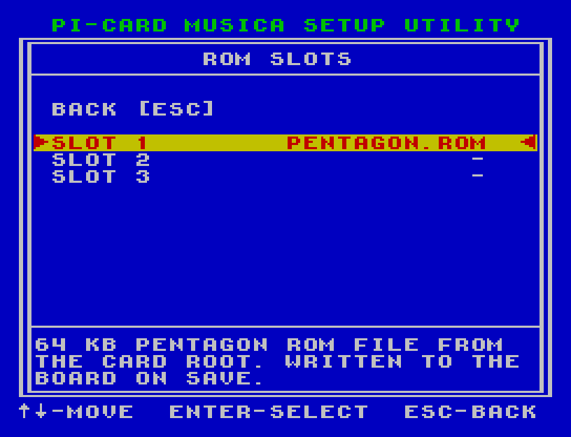

`ENTER` на месте открывает список файлов `.rom` из корня карты; в нём
только файлы размером ровно 64 КБ с именем не длиннее 31 знака, не больше
16 файлов. Первая строка списка, `NONE`, освобождает место. В окне видно
5 строк, остальные - стрелками вверх и вниз; черта `---` над списком или
под ним значит, что там есть ещё.

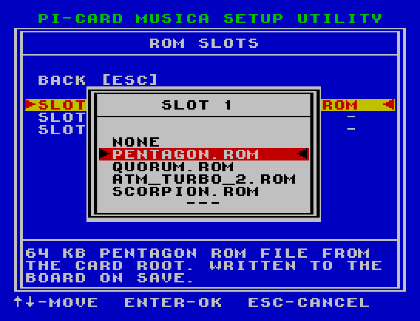

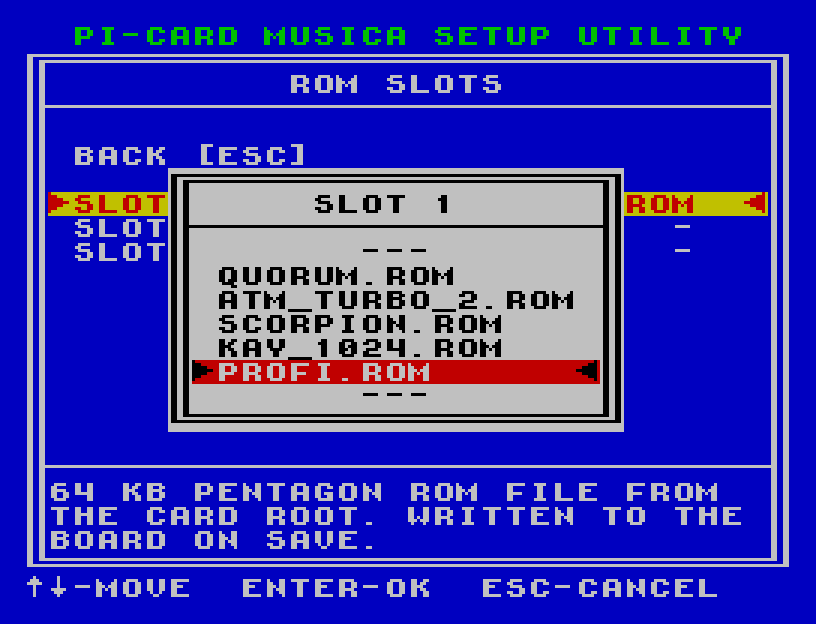

Плата записывает файл к себе при перезагрузке после сохранения. Дальше при каждой загрузке
она сверяет файл на карте с записанным и переписывает места, где они
разошлись. Если файла на карте нет, остаётся записанное раньше. Какое ПЗУ
включено, выбирает пункт `MACHINE ROM` на главном экране: `BOARD` - ПЗУ
самой машины, или одно из своих - по имени файла. Если выбранное место
пустое, работает ПЗУ машины.

Если плата не держит машину в сбросе (`RESET_SIGNAL=0`), своё ПЗУ
включается после сброса машины: при включении вместе с машиной - сразу,
а если машина уже работала (выход из конфигуратора, `Ctrl`+`Alt`+`Del`) -
на экране мусор, нажмите сброс.

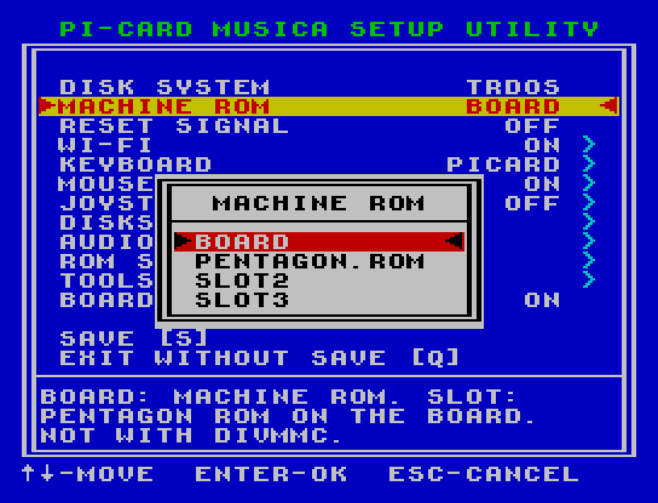

### Инструменты

Раздел `TOOLS` - сведения и проверки, настроек он не меняет.

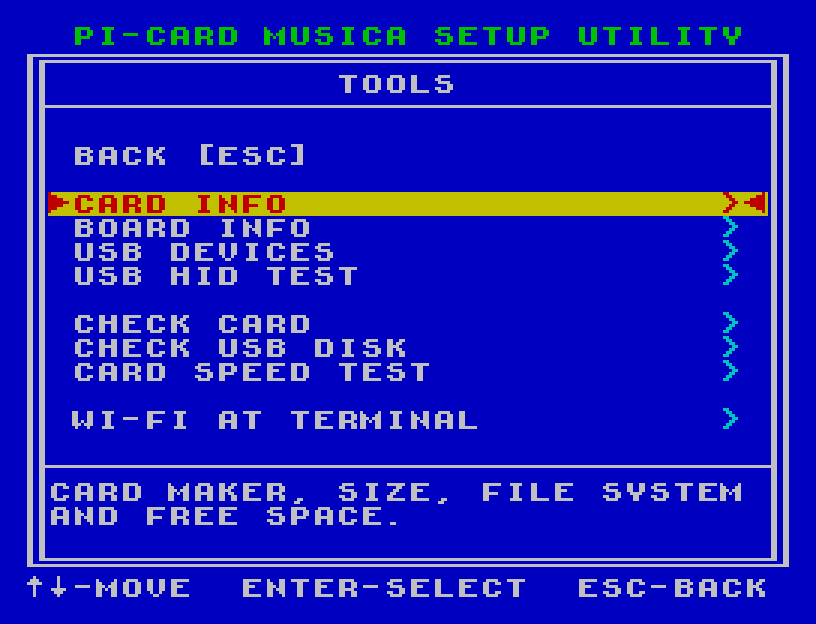

| Пункт | Что показывает или делает |
|---|---|
| `CARD INFO` | карта: тип, объём, производитель, имя, ревизия, серийный номер, дата выпуска; файловая система, метка тома, кластер, свободное место по записи FSINFO в томе |
| `BOARD INFO` | версия прошивки, чип, частота, флеш, PSRAM, сколько мест под своё ПЗУ занято (`ROM SLOTS 1 OF 3 USED`), время работы |
| `USB DEVICES` | подключённые устройства USB: адрес, VID:PID, скорость и для чего плата их взяла (`KEYBOARD`, `MOUSE`, `GAMEPAD`, `DISK`, `HUB` или `NOT USED`) |
| `USB HID TEST` | что присылают мышь, клавиатура и джойстик и как плата это читает; запись отчёта на карту |
| `CHECK CARD`, `CHECK USB DISK` | проверка файловой системы карты или флешки |
| `CARD SPEED TEST` | на какой частоте карта читается без ошибок |
| `WI-FI AT TERMINAL` | команды модулю Wi-Fi с клавиатуры |

Назад - `ESC` или забой; в терминале Wi-Fi забой стирает знак, назад -
только `ESC`. `BOARD INFO` и `USB DEVICES` обновляются раз в секунду.
Размеры меньше 1 КБ показываются в байтах, например `512 B`.

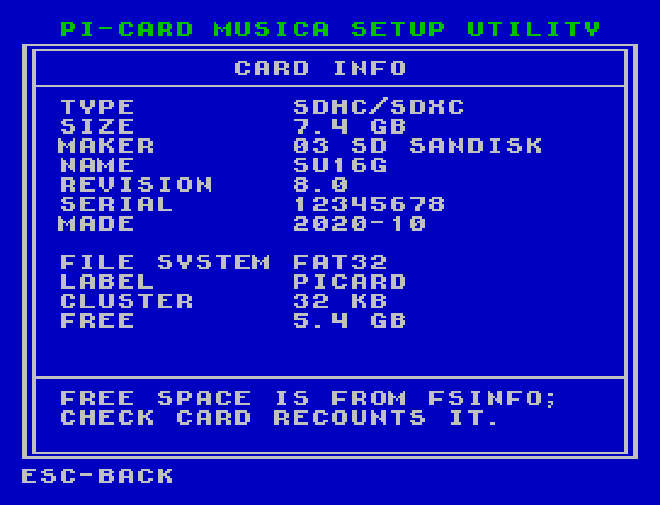

**Проверка карты и флешки.** Плата читает таблицу размещения (FAT) и
считает свободное место заново. Пока вы не нажмёте `ENTER`, на носитель
ничего не пишется. Карта на 8 ГБ проверяется за несколько секунд, `ESC`
прерывает проверку. FAT12 не проверяется: на экране только том, размер и
кластер. `NO CARD` (`NO USB DISK`) - носителя нет, `NO FAT ON THE CARD` -
на носителе нет тома FAT.

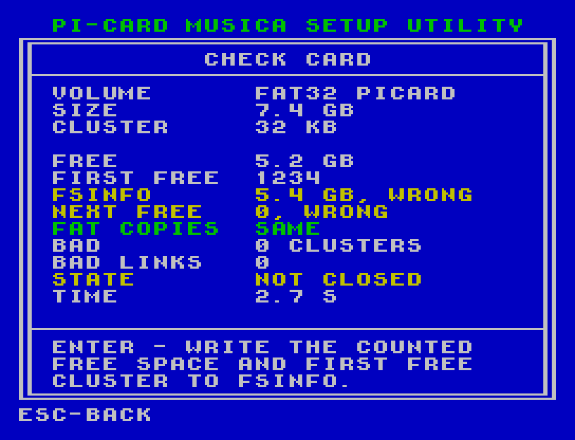

| Строка | Что значит |
|---|---|
| `FREE` | свободно по подсчёту |
| `FIRST FREE` | первый свободный кластер по подсчёту |
| `FSINFO` | свободно по записи в самом томе; `WRONG` - запись разошлась с подсчётом, и компьютер покажет неверное свободное место |
| `NEXT FREE` | с какого кластера программы ищут свободное место; `WRONG` - пусто, за пределами тома или перед длинным занятым участком: создание файла или каталога перебирает этот участок таблицы, на машине это минуты |
| `FAT COPIES` | у тома две одинаковые таблицы; `DIFFER` - они разошлись |
| `BAD` | кластеры, помеченные плохими |
| `BAD LINKS` | ссылки в таблице за пределы тома |
| `STATE` | `NOT CLOSED` - том не закрыли после записи, например вынули карту на ходу |
| `TIME` | сколько шла проверка |
| `READ ERROR, FAT SECTOR` | сектор таблицы не прочитался; исправление в этом случае не предлагается |

Если `FSINFO` или `NEXT FREE` неверны, `ENTER` записывает в FSINFO
подсчитанное свободное место и первый свободный кластер; после записи
строка показывает `FSINFO FIXED`. Остальное здесь только показывается:
исправляют это на компьютере (в Windows - `chkdsk`).

**Проверка мыши, клавиатуры и джойстика.** На экране - каждое подключённое
устройство, по интерфейсу на строку: адрес и номер интерфейса, VID:PID,
чем плата его взяла (`MOUSE`, `KEYB`, `PAD` или `NONE` - не взято) и
протокол (`BOOT` или `REPORT`). Строкой ниже - что плата прочла из
последнего отчёта: у клавиатуры - байт модификаторов (`MOD`) и код первой
клавиши (`KEY`), у мыши и джойстика - длина отчёта, оси `X`, `Y` и
кнопки (`B`). `NO REPORT YET` - отчётов ещё не было, `NOT DECODED` -
отчёт пришёл, но плата его не разобрала. Подвигайте мышью, понажимайте
кнопки и посмотрите, меняются ли числа.

Если устройство работает не так, отпустите его или держите нажатой одну
кнопку и нажмите `ENTER`: в корень карты запишется файл `USB_HID.TXT` с
описанием устройства и последним отчётом. Пришлите этот файл вместе с
описанием, что не так, - по нему видно, где ошибка.

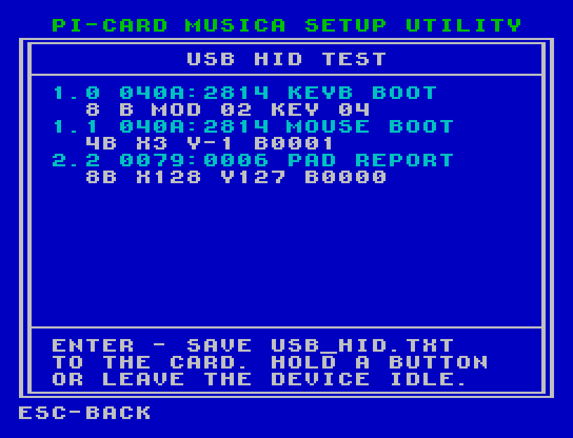

**Проверка частоты карты.** Плата читает карту на каждой частоте, от
меньшей к большей, одни и те же места на каждой частоте, и считает
ошибки. На карту ничего не пишется. Проверка идёт около десяти секунд.
`ESC` её останавливает (на экране `STOPPED`), второй `ESC` - назад.
Строка `IN SETUP` - частота, которая стоит в настройках сейчас.

| Результат в строке частоты | Что значит |
|---|---|
| `NO ERRORS` и число | ошибок нет; число - скорость чтения, КБ/с |
| `N ERRORS` | на этой частоте N ошибок чтения |
| `DATA DIFFERS` | чтения прошли, но данные не совпали с первой частотой без ошибок |
| `NO HIGH SPEED` | карта эту частоту не умеет и работает на 25 МГц |

Данные сверяются с первой строкой без ошибок, поэтому отказ на одной
частоте не портит сверку остальных. В конце - самая быстрая частота без
ошибок (`FASTEST CLEAN`); поставьте её в `DISKS AND DRIVES` - `SD CARD
MHZ`. Если такой нет - `NO CLOCK WITHOUT ERRORS`. Частоту с ошибками или
с `DATA DIFFERS` не ставьте, даже если ошибки редкие.

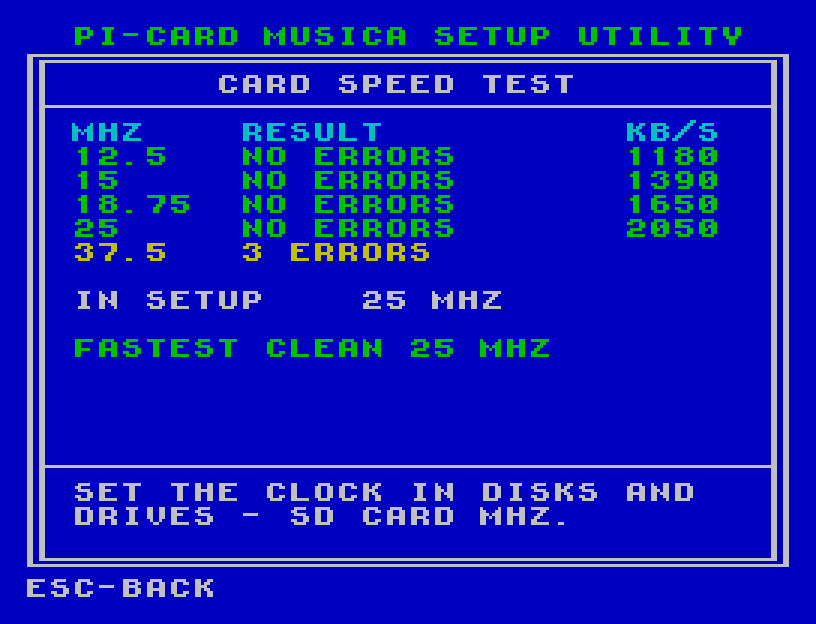

**Терминал модуля Wi-Fi.** Работает при любом значении `WIFI`; к сети
плата в конфигураторе не подключается. Плата сама находит скорость
модуля. Наберите команду и нажмите `ENTER`, ответ модуля появится выше
строки ввода. Стрелки вверх и вниз подставляют готовые команды, `DEL`
стирает знак.

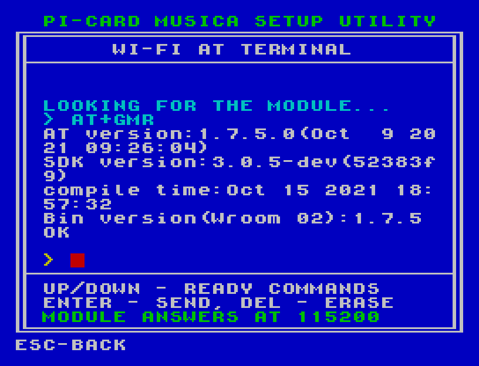

| Команда | Что делает |
|---|---|
| `AT` | проверка связи, ответ `OK` |
| `AT+GMR` | версия прошивки модуля |
| `AT+CWMODE?` | режим модуля |
| `AT+CWLAP` | сети вокруг |
| `AT+CWJAP?` | к какой сети подключён |
| `AT+CIFSR` | адрес модуля |
| `AT+UART_CUR?` | скорость порта |
| `AT+RST` | перезапуск модуля |
| `AT+RESTORE` | заводские настройки модуля |

Буквы вне кавычек становятся заглавными сами, а имя сети и пароль в
кавычках набираются как есть. Нижняя строка - состояние модуля:

| Строка | Что значит |
|---|---|
| `MODULE ANSWERS AT N` | модуль ответил на скорости N бод |
| `MODULE DOES NOT ANSWER` | модуль молчит: проверьте провода GPIO38 и GPIO39 |
| `ROM LOADER AT N` | модуль запущен в режиме загрузчика прошивки и на команды AT не отвечает |

### Недоступные пункты

Часть настроек имеет смысл не всегда. Зависимости из таблицы ниже
проверяет только конфигуратор: недоступный пункт в нём не меняется.
При чтении файла с карты они не проверяются, за тремя исключениями,
которые действуют и в конфигураторе:

- при `DISKSYS=DIVMMC` `RESET_SIGNAL` принудительно равен 1;
- при `DISKSYS=DIVMMC`, если выключены обе карты DivMMC, первая
  включается на `SD`;
- при `WIFI=1` значение `LIVE_MIDI=WIRE` заменяется на `NONE`.

| Пункт | Недоступен |
|---|---|
| `RESET_SIGNAL` | когда `DISKSYS=DIVMMC`: он принудительно единица |
| `ROM` (`MACHINE ROM`), `ROM1_FILE`..`ROM3_FILE` (`SLOT 1`..`SLOT 3`) | когда `DISKSYS=DIVMMC` |
| `MOD_*` | когда `KEYBOARD_LAYOUT=NONE` |
| `MOUSE_SPEED`, `MOUSE_SWAP_BUTTONS`, `MOUSE_AUTOSWAP` | когда `USB_MOUSE=0` |
| `JOY_*` (клавиши джойстика) | когда `KEYBOARD_LAYOUT=NONE` |
| `JOY_FIRE2`..`JOY_FIRE4` | ещё и когда `JOY_8BIT=0` |
| `WIFI_SSID`, `WIFI_PASSWORD` | когда `WIFI=0` |

Недоступный пункт видно чёрными буквами, курсор на него встаёт, но
`ENTER` значение не меняет. `RESET_SIGNAL` при включённом DivMMC не просто
закрыт - он принуждён к единице: DivMMC грузит машину со своей карты, а
для этого обязан её сбросить. `ROM` при `DISKSYS=DIVMMC` хранится, но не
действует: ПЗУ машине подставляет DivMMC.

## Файлы на карте

Кладутся в корень. Плата разбирает их при включении, **до** того как
поднимет шину.

| Файл | Что делает | Во что переименуется |
|---|---|---|
| `set_config.txt` | применить настройки из него | `set_config.done` |
| `get_config.txt` | записать в него нынешние настройки | `get_config.done` |
| `open.gui` | загрузиться в конфигуратор | удаляется при выходе |

Переименование - признак того, что файл отработал: иначе он применялся бы
при каждом включении, а вы бы не знали, прочитан он или нет.

`get_config.txt` кладётся **пустым**: плата запишет в него полный файл с
комментариями, который можно поправить и вернуть как `set_config.txt`.

### Формат

Построчный: `ПАРАМЕТР=ЗНАЧЕНИЕ`. Пустые строки, строки с `;` или `#` в
начале и строки без `=` пропускаются.

```
; это комментарий
GS=1
```

Пробелы внутри строки отбрасываются, имя параметра и значение
сверяются без учёта регистра. Исключение - имя сети, пароль и имена
файлов ПЗУ (`WIFI_SSID`, `WIFI_PASSWORD`, `ROM1_FILE`..`ROM3_FILE`): у
них значение - всё после `=` без пробелов по краям, регистр и пробелы
внутри сохраняются. Для включения годятся `1`, `ON`, `YES`, `TRUE`, для
выключения - `0`, `OFF`, `NO`, `FALSE`.

**Неизвестный параметр и неразборчивое значение пропускаются, а
остальные строки применяются** - опечатка в одной строке не отменяет весь
файл. Число вне допустимых пределов тоже считается неразборчивым. Сколько
параметров легло, сколько не узнано и сколько не разобрано, плата
печатает в журнал.

Чего в файле нет, остаётся прежним. То есть файл из одной строки меняет
одну настройку.

Файл короче 10 байт или длиннее 8191 байта не обрабатывается: он
отбрасывается без переименования и без сообщения в журнал. Короче 10
байт, например, записи `GS=0` (5 байт с переводом строки), `LOG=0` (6) и
`WIFI=1` (7). Чтобы задать одну из них, файл нужно дополнить второй
строкой или пробелами.

## Параметры

Готовые файлы под три машины лежат в релизе, в каталоге `example`.

### Память и диски

| Параметр | Значения | По умолчанию | Что делает |
|---|---|---|---|
| `DISKSYS` | `NONE`, `DIVMMC`, `TRDOS` | `NONE` | дисковая система машины |
| `DIVMMC_CARD1` | `NONE`, `SD`, `USB` | `NONE` | первая карта DivMMC на портах `E7h`/`EBh` и её носитель |
| `DIVMMC_CARD2` | `NONE`, `SD`, `USB` | `NONE` | вторая карта DivMMC на тех же портах и её носитель |
| `ZCONTROLLER` | `NONE`, `SD`, `USB` | `NONE` | Z-Controller на портах `57h`/`77h` и его носитель |
| `SD_SPEED` | `12.5`, `15`, `18.75`, `25`, `37.5` | `25` | частота карты, МГц; проверьте карту в `TOOLS` - `CARD SPEED TEST` |

Значение устройства - носитель, с которого оно берёт секторы: `SD` -
карта платы, `USB` - флешка в разъёме платы. `NONE` выключает
устройство: его порты для машины пустые.

Карты DivMMC работают при любом `DISKSYS`. Первую машина выбирает битом 0
порта `E7h`, вторую - битом 1. При `DISKSYS=DIVMMC` хотя бы одна карта
включена всегда: если выключены обе, плата включает первую на `SD`. Если
у машины свой интерфейс карты на портах `E7h`/`EBh`, карты DivMMC платы
нужно выключить.

Прежние параметры `DISKSYS_MEDIA`, `ZCONTROLLER_MEDIA` и `ZCONTROLLER=0`/`1`
плата в файле не узнаёт и пропускает. Настройки, сохранённые прежней
прошивкой во флеше платы, переносятся сами.

Все устройства на `USB` допустимо, но
**файлы настроек, `open.gui` и банк инструментов читаются только с
карты**. Без карты оба эмулятора работают с флешки, а настройки
доступны только через конфигуратор по сочетанию клавиш.

`DISKSYS=DIVMMC` - плата подставляет машине ПЗУ и память, машина грузится
с карты платы. `DISKSYS=TRDOS` - плата работает как Beta Disk с четырьмя
дисководами и включает TR-DOS сигналом `DOS_N` на GPIO36. Две дисковые
системы сразу не работают.

При `DISKSYS=TRDOS` образы TRD и SCL с карты или флешки вставляет в
дисководы меню образов дисков по NMI; оно же собирает диск из отдельных
файлов ([usage.md](usage.md), раздел "Меню образов дисков"). Образ TRD
может быть длиннее 640 КБ - до 1 МБ, 128 дорожек. Записанное на диск сразу
попадает в файл образа. У SCL в файл попадают только изменения внутри уже
записанных файлов; новые файлы и каталог SCL живут до извлечения образа.
Диск, собранный из файлов, только для чтения. Если у машины свой Beta
Disk, его нужно отключить: на его портах отвечает плата. Без своего ПЗУ
платы TR-DOS берётся из ПЗУ машины. Дисководы платы занимают около 440 КБ
памяти, в которую грузятся треки.

Со своим ПЗУ (`MACHINE ROM` не `BOARD`) дисководы платы пока не работают:
TR-DOS берётся из своего ПЗУ, а диски - от Beta Disk машины, если он есть.

TR-DOS включается так же, как на настоящем Beta Disk: только когда
выбрано ПЗУ 48 - из меню 128 пунктами TR-DOS и 48 BASIC или
`RANDOMIZE USR 15616` из бейсика 48. В бейсике 128 он сам не
включается. Выбор ПЗУ плата узнаёт по записям машины в порт `7FFD`, так
что после перезагрузки одной платы, без сброса машины, TR-DOS станет
доступен только после нового выбора ПЗУ или сброса машины.

`ZCONTROLLER=NONE` ставят, когда на портах `57h`/`77h` отвечает своё
железо, - два устройства на одном чтении дадут конфликт на шине.

На один носитель пишет только тот интерфейс, который записал на него
первым; остальные до сброса машины его только читают. Так DivMMC и
Z-Controller не портят друг другу файловую систему, если смотрят на одну
и ту же карту.
Обе карты DivMMC на одном носителе машина видит одной файловой системой
на двух дисках, и писать на неё сможет только через одну из них.

Носитель `USB` - флешка в разъёме платы. Её можно вставить и после
включения платы: устройство машины увидит её как только что вставленную
карту.

### Звук

| Параметр | Значения | По умолчанию | Что делает |
|---|---|---|---|
| `GS` | `0`, `1` | `1` | эмуляция General Sound на портах `BBh`/`B3h` |
| `GS_FX_SEPARATE` | `0`, `1` | `0` | звуковые эффекты General Sound не прерывают музыку |
| `LIVE_MIDI` | `NONE`, `HOOK`, `WIRE` | `HOOK` | откуда берётся живой поток MIDI |
| `AY_EMULATION` | `NONE`, `AY8910`, `YM2149`, `TS 2xYM2149`, `TSFM 2xYM2203` | `NONE` | плата сама играет музыку AY |
| `AY_STEREO` | `ACB`, `ABC`, `MONO` | `ACB` | как каналы AY разложены по стерео |
| `SAA1099` | `0`, `1` | `0` | плата играет музыку SAA1099, как карта MultiSound |
| `COVOX` | `0`, `1` | `0` | плата играет Covox на порту `#FB` |
| `SOUNDRIVE` | `0`, `1` | `0` | плата играет Soundrive 1.05 |
| `BEEPER` | `NONE`, `1BIT`, `2BIT` | `NONE` | плата играет бипер |
| `STOP_MUSIC_ON_RESET` | `0`, `1` | `1` | сброс машины останавливает музыку платы |
| `AUTO_VOLUME` | `0`, `1` | `0` | плата сама выравнивает громкость треков |
| `MOD_PANNING` | `0`..`100` | `100` | ширина стерео у MOD, процент от разводки Amiga |
| `MOD_INTERPOLATION` | `0`/`1` | `1` | сглаживание сэмплов MOD: `1` - плавно, `0` - лесенкой, как на Amiga |

`STOP_MUSIC_ON_RESET=1` - после сброса машины плата перестаёт играть то,
что играла сама: музыку General Sound (карта при этом сбрасывается, как
настоящая), музыкальные файлы и MIDI. При `0` музыка после сброса играет
дальше. Остановить музыку без сброса - `F10`.

`GS_FX_SEPARATE=0` - как у настоящей карты: звук эффекта в игре на время
заглушает одну из партий музыки. При `1` музыка играет целиком, а
эффекты звучат поверх неё.

`AY_EMULATION` - плата играет музыку AY своим звуком и сама отвечает
программе на чтение регистров чипа, поэтому программа находит тот чип,
который выбран здесь: одиночный, TurboSound или TurboSound FM. Родной AY
машины звучит, как и раньше. Если он в машине есть, звук будет двойным, а
программа может прочитать не то, что отвечает плата: оставьте `NONE` или
уберите родной. `AY8910` - звук AY-3-8910, `YM2149` - звук YM2149, у него
огибающая мягче. `TS 2xYM2149` - TurboSound: два YM2149, программа выбирает
чип записью `#FE` или `#FF` в порт `#FFFD`; музыка для TurboSound играет
шесть каналов. `TSFM 2xYM2203` - TurboSound FM: два YM2203, у каждого к
трём каналам AY добавлены три канала FM. FM звучит, когда программа
включит его записью в порт `#FFFD`, как на настоящей карте; музыка для
обычного AY и TurboSound в этом режиме играет как раньше. Таймеров YM2203
у платы нет: программа, которая проверяет FM по таймеру чипа, его не
найдёт.

`AY_STEREO` - раскладка каналов AY. `ACB` - как у Пентагона: канал A
слева, B справа, C посередине. `ABC` - посередине B. `MONO` - все три
канала в обоих динамиках.

`SAA1099=1` - плата играет музыку для чипа SAA1099 так, как её играет
карта MultiSound: программа пишет в порты `#FF` и `#1FF`. Звук появляется,
когда программа включит чип записью `#F7` в порт `#FFFD`, и пропадает
после записи `#FF` туда же или сброса машины. Пока работает TR-DOS, порт
`#FF` принадлежит дисководу, и записи в него чип не получает.

`COVOX=1` - плата играет то, что программа пишет в порт `#FB`, в обоих
каналах.

`SOUNDRIVE=1` - плата играет Soundrive 1.05: порты `#0F` и `#1F` -
левый канал, `#4F` и `#5F` - правый. Вместе с `COVOX=1` порт `#FB`
звучит в обоих каналах поверх Soundrive. Пока работает TR-DOS, порты
`#1F` и `#5F` принадлежат дисководу, и звука от них нет.

`BEEPER` - плата играет бипер машины, порт `#FE`. `1BIT` - однобитный
бипер: звучит только бит 4. `2BIT` - двухбитный: к биту 4 подмешан бит 3,
сигнал записи на магнитофон, в 10 раз тише - так они смешаны на выходе
ULA 48K. Свой динамик машины при этом звучит дальше.

`MOD_PANNING` - насколько широко MOD звучит в стерео. `100` - как на
Amiga: половина партий слева, половина справа. `0` - всё по центру.
Если мелодия сама двигает партии по стерео, их размах сужается так же.
Прочих форматов эта настройка не касается.

`MOD_INTERPOLATION` - как играются сэмплы MOD. `1` - плавно, как в
трекерах на PC. `0` - лесенкой, как звуковой чип Amiga: каждый отсчёт
сэмпла держится до следующего. Прочие форматы всегда играют плавно.

Модуль, залитый в General Sound программой машины, звучит как у карты:
партии 1 и 2 слева, 3 и 4 справа, сэмплы лесенкой. `MOD_PANNING` и
`MOD_INTERPOLATION` на него не действуют.

`LIVE_MIDI=HOOK` - плата слушает записи машины в порт AY и играет их
банком инструментов.

При `GS=1` и `LIVE_MIDI=NONE` **файлы `.mid` через General Sound не
звучат**. Эмуляция карты разбирает `.mid` и отдаёт очередную порцию байт
MIDI по запросу, а в поток эти байты записывает программа на машине -
через порт A звукогенератора. Этот порт и читает живой MIDI, а при
`NONE` чтение выключено. Модули и эффекты не затронуты.

**`WIRE` равносилен `HOOK`**: приёма с провода в прошивке нет,
проверяется только условие "режим не `NONE`", поэтому при `WIRE`
читается порт A звукогенератора. GPIO33, отведённый под провод, занят
приёмом журнала. Параметр хранится и печатается, чтобы не менять формат
файла, когда приём будет реализован.

`AUTO_VOLUME=1` - плата выравнивает громкость треков, которые играет из
файлов: тихий трек делает громче (не больше чем на 18 дБ), громкий - тише
(не больше чем на 12 дБ). Громкость трека берётся по первым секундам и
дальше подстраивается медленно. На музыку AY и General Sound из программ настройка
не действует.

При `WIFI=1` значение `LIVE_MIDI=WIRE` заменяется на `NONE` (см.
"Плата" ниже), и тогда `.mid` через General Sound не звучат.

### Машина

| Параметр | Значения | По умолчанию | Что делает |
|---|---|---|---|
| `RESET_SIGNAL` | `0`, `1` | `0` | плата может подавать машине сброс |

При `0` плата не подаёт машине сброс ни при каком событии: ни по клавише
`F12`, ни по `Ctrl`+`Alt`+`Del` с клавиатуры USB, ни на собственной
загрузке. `Ctrl`+`Alt`+`Del` перезапускает только плату, машина при этом
продолжает работать. Исключение одно - вход в конфигуратор: без сброса
машины в него не попасть, и это явное действие пользователя. При
`DISKSYS=DIVMMC` он принудительно `1`: DivMMC требует сброса машины.

Нажатие кнопки сброса на самой машине плата замечает сама, отдельный
провод не нужен. После него TR-DOS выключается, а клавиатура
возвращается в обычный режим. Это работает при любом `RESET_SIGNAL`,
кроме `DISKSYS=DIVMMC`: там машину сбрасывает сама плата.

### Своё ПЗУ

| Параметр | Значения | По умолчанию | Что делает |
|---|---|---|---|
| `ROM` | `BOARD`, `SLOT1`, `SLOT2`, `SLOT3` | `BOARD` | ПЗУ машины: `BOARD` - ПЗУ самой машины, `SLOT1`..`SLOT3` - образ из места на плате; при `DISKSYS=DIVMMC` не действует |
| `ROM1_FILE` | имя файла в корне карты, до 31 знака | пусто | образ ПЗУ Пентагона 64 КБ для места 1 |
| `ROM2_FILE` | то же | пусто | то же для места 2 |
| `ROM3_FILE` | то же | пусто | то же для места 3 |

При загрузке плата сверяет файл с местом и переписывает его, если они
разошлись. Файл другого размера, чем 64 КБ, не записывается, в журнал
идёт строка `boot: ROM slot N: ... is ... B, not 65536`. В конфигураторе
это раздел `ROM SLOTS` и пункт `MACHINE ROM` (см. "Своё ПЗУ машины"
выше); там вместо `SLOT1`..`SLOT3` показаны имена файлов.

```
ROM1_FILE=pentagon.rom
ROM=SLOT1
```

### Клавиатура USB

| Параметр | Значения | По умолчанию | Что делает |
|---|---|---|---|
| `KEYBOARD_LAYOUT` | `PICARD`, `NONE` | `NONE` | раскладка; `NONE` выключает клавиатуру |
| `MOD_RIGHT_SHIFT` | `CAPS`, `SYMBOL`, `NONE` | `CAPS` | чем становится правый Shift |
| `MOD_LEFT_CTRL` | `CAPS`, `SYMBOL`, `NONE` | `SYMBOL` | чем становится левый Ctrl |
| `MOD_RIGHT_CTRL` | `CAPS`, `SYMBOL`, `NONE` | `SYMBOL` | чем становится правый Ctrl |
| `MOD_LEFT_ALT` | `CAPS`, `SYMBOL`, `NONE` | `NONE` | чем становится левый Alt |
| `MOD_RIGHT_ALT` | `CAPS`, `SYMBOL`, `NONE` | `NONE` | чем становится правый Alt |

Левый Shift не настраивается: он выбирает верхний знак клавиши, а не роль
на матрице.

Клавиатуру выключают на машине со своей: плата выводит матрицу на порт
`0xFE`, и на машине с собственной клавиатурой это два источника в одном
цикле. Выключенная клавиатура на шину не выходит, но сочетания с платой
работают, пока поднят USB: его поднимает мышь, пульт или носитель USB у
включённого эмулятора. Если USB не нужен никому, плата его не поднимает
вовсе (он отнимает время у шины), и вернуть клавиатуру можно перемычкой
или файлом `open.gui`. В конфигураторе клавиатура USB работает всегда.

Сочетания клавиш платы:

| Сочетание | Что делает |
|---|---|
| `Win`+`F12` | конфигуратор; машина при этом сбрасывается при любом `RESET_SIGNAL` |
| `F12` | сброс машины, только при `RESET_SIGNAL=1` |
| `Ctrl`+`Alt`+`Del` | перезапуск платы; машина сбрасывается только при `RESET_SIGNAL=1` |
| `F11` | NMI машины |
| `F10` | остановить музыку платы, машину не сбрасывая |
| `Win`+`F2` | клавиши джойстика становятся джойстиком Kempston |
| `Win`+`F1` | обычный режим клавиатуры |
| `Win`+`F3` | при `DISKSYS=TRDOS` - образы дисководов A и B местами |

`Win`+`F2` переводит клавиши джойстика (по умолчанию стрелки, пробел и
`Enter`) в джойстик Kempston, `Win`+`F1` возвращает обычный режим. Порт
Kempston в этом режиме занят и при `USB_GAMEPAD=0`. После сброса машины
(`F12`, `Ctrl`+`Alt`+`Del`, `Win`+`F12` или кнопкой на самой машине) или
NMI (`F11`) клавиатура сама становится обычной.

При `DISKSYS=TRDOS` сочетание `Win`+`F3` меняет местами образы в дисководах
A и B, если вставлены оба.

### Мышь и джойстик USB

| Параметр | Значения | По умолчанию | Что делает |
|---|---|---|---|
| `USB_MOUSE` | `0`, `1` | `0` | мышь USB как Kempston |
| `MOUSE_SPEED` | `1`..`32` | `4` | скорость в четвертях: `4` - один к одному, `8` - вдвое быстрее |
| `MOUSE_SWAP_BUTTONS` | `0`, `1` | `0` | поменять местами левую и правую кнопки |
| `MOUSE_AUTOSWAP` | `0`, `1` | `0` | обе кнопки, зажатые полсекунды, меняют левую и правую местами до выключения |
| `USB_GAMEPAD` | `0`, `1` | `0` | пульт USB как джойстик Kempston |
| `JOY_8BIT` | `0`, `1` | `0` | Kempston восьмиразрядный: разряды 5..7 - ещё три кнопки |

При `JOY_8BIT=0` разряды 5..7 порта всегда нули, как у простого
интерфейса.

### Клавиши джойстика

Какие клавиши в режиме `Win`+`F2` становятся джойстиком. На каждое
действие до двух клавиш через запятую, `NONE` - ни одной.

| Параметр | По умолчанию | Разряд порта |
|---|---|---|
| `JOY_RIGHT` | `RIGHT` | 0 |
| `JOY_LEFT` | `LEFT` | 1 |
| `JOY_DOWN` | `DOWN` | 2 |
| `JOY_UP` | `UP` | 3 |
| `JOY_FIRE` | `SPACE,ENTER` | 4 |
| `JOY_FIRE2` | `NONE` | 5, только при `JOY_8BIT=1` |
| `JOY_FIRE3` | `NONE` | 6, только при `JOY_8BIT=1` |
| `JOY_FIRE4` | `NONE` | 7, только при `JOY_8BIT=1` |

Имена клавиш: `A`..`Z`, `0`..`9`, `F1`..`F12`, `UP`, `DOWN`, `LEFT`,
`RIGHT`, `ENTER`, `SPACE`, `TAB`, `INSERT`, `DELETE`,
`HOME`, `END`, `PAGEUP`, `PAGEDOWN`, `CAPSLOCK`, `PRINTSCREEN`,
`SCROLLLOCK`, `PAUSE`, `NUMLOCK`, `MINUS`, `EQUAL`, `LBRACKET`,
`RBRACKET`, `BACKSLASH`, `SEMICOLON`, `QUOTE`, `GRAVE`, `COMMA`,
`PERIOD`, `SLASH`, цифровая клавиатура - `KP_0`..`KP_9`, `KP_ENTER`,
`KP_PLUS`, `KP_MINUS`, `KP_STAR`, `KP_SLASH`, `KP_DOT`. `ESC` и
`BACKSPACE` не привязываются: в конфигураторе они отменяют. Модификаторы (`Shift`, `Ctrl`, `Alt`) не привязываются:
у них свои роли.

Клавиша, ставшая джойстиком, в матрицу ZX в этом режиме не идёт.

```
JOY_UP=UP,Q
JOY_FIRE=SPACE
```

В конфигураторе это таблица `JOYSTICK KEYS` в разделе `KEYBOARD`:
столбец `KEY 1` - первая клавиша действия, `KEY 2` - вторая; клавиша
задаётся нажатием.

### Плата

| Параметр | Значения | По умолчанию | Что делает |
|---|---|---|---|
| `LOG` | `0`, `1` | `1` | журнал на GPIO32, 115200 бод |
| `WIFI` | `0`, `1` | `0` | модуль Wi-Fi |
| `WIFI_SSID` | имя сети, до 32 знаков | пусто | к какой сети подключаться |
| `WIFI_PASSWORD` | до 63 знаков | пусто | пароль сети; пусто - открытая сеть |

`LOG` сейчас ни на что не влияет: журнал на GPIO32 выводится при любом
значении.

`WIFI` занимает GPIO34, 38 и 39, а с ними блок UART1 целиком, поэтому
вместе с `LIVE_MIDI=WIRE` он не работает: провод MIDI сидит на
единственном оставшемся приёмнике. При `WIFI=1` плата заменяет
`LIVE_MIDI=WIRE` на `NONE` - и в файле, и в конфигураторе.

Модуль - ESP32 с прошивкой ESP-AT. При `WIFI=1` плата после включения
подключается к сети `WIFI_SSID` и пишет в журнал, чем это кончилось.
Сеть и пароль задаются в конфигураторе (поля доступны при `WIFI=1`) или
в файле:

```
WIFI_SSID=Home Net
WIFI_PASSWORD=secret 123
```

В файле значение - всё после `=`, без пробелов по краям; регистр и
пробелы внутри сохраняются. В `get_config.done` пароль не пишется:
вместо него строка-комментарий, и такой файл, залитый обратно, пароль не
стирает.

## Выводы платы

Здесь только те, которыми распоряжаются настройки. Остальные заняты
шиной Z80, картой, звуком и PSRAM.

| Вывод | Что на нём | Настройка |
|---|---|---|
| GPIO32 | журнал, передача, 115200 8N1 | `LOG` |
| GPIO33 | будущий вход MIDI по проводу; сейчас отдан UART журнала, плата с него не читает | |
| GPIO34 | `/WAIT` шины машины, открытый сток | `DISKSYS=TRDOS`, `WIFI` |
| GPIO36 | `DOS_N`, выход, активен нулём | `DISKSYS=TRDOS` |
| GPIO38 | Wi-Fi, передача | `WIFI` |
| GPIO39 | Wi-Fi, приём | `WIFI` |

Приём умеют только 33 и 39, и оба заняты: 33 журналом, 39 модулем Wi-Fi.
Отсюда и то, что провод MIDI с Wi-Fi вместе не живут, и то, что при
`LOG=1` провод не заработает вовсе. Когда он появится, ему понадобится
оптопара: выводы RP2350 не терпят 5 В.

## Что видно в журнале

При старте плата печатает, откуда взяла настройки и что с ними сделала:

```
boot: settings from flash, set_config.txt: applied 6, unknown 0, invalid 0, block 1 written (set_config.txt)
boot: settings by step, ms: mount 12, read 3, flash 45, write 0, rename 0, unmount 0
boot: disk divmmc, divmmc cards sd none, z-controller sd, gs 1, live midi hook, reset 1, wifi 0
boot: keyboard 1, mouse 1 (speed 4), gamepad 0
```

Первая строка говорит, нашёлся ли годный блок во флеше, применялся ли
файл с карты и кто переписал блок. `NOT RENAMED` в ней значит, что
`set_config.txt` не удалось переименовать и он применится снова при
следующей загрузке; `get_config.done saved` - выгрузка настроек записана.
Вторая - время шагов в миллисекундах. Две последние - сами настройки, как
их поняла плата.

При `WIFI=1` чуть позже приходят строки модуля Wi-Fi:

```
wifi: joining "Home Net"
wifi: joined in 3120 ms
wifi: +CIPSTA:ip:"192.168.1.57"
```

Если сеть не подключилась, вместо этого будет `wifi: join failed` с
кодом: `+CWJAP:1` - сеть не ответила, `2` - неверный пароль, `3` -
сети с таким именем нет, `4` - отказ подключения. `wifi: module does not
answer` - модуль не отвечает: проверьте провода GPIO38 и GPIO39.
`WIFI_SSID is empty - not connecting` - имя сети не задано.

Вход в конфигуратор печатает, каким путём он случился, и сколько файлов
ПЗУ нашлось в корне карты:

```
boot: configurator (key)
boot: configurator ROM files 2
```

`key` - сочетание клавиш, `jumper` - перемычка, `open.gui` - файл.
