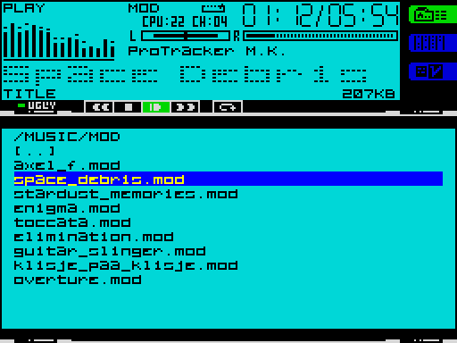
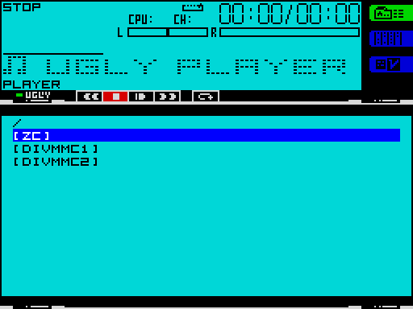
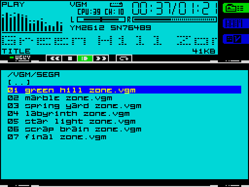
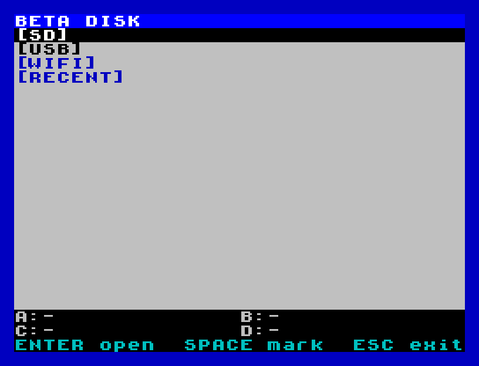
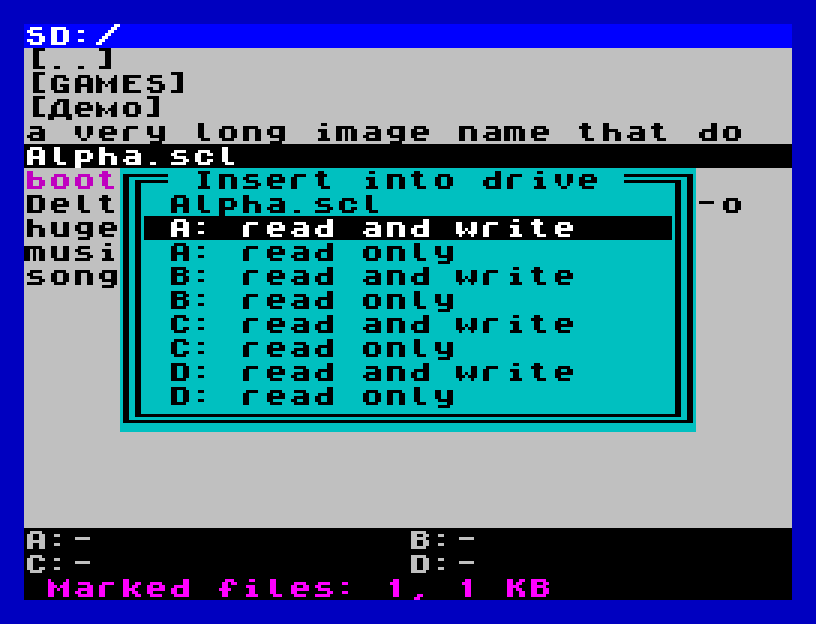
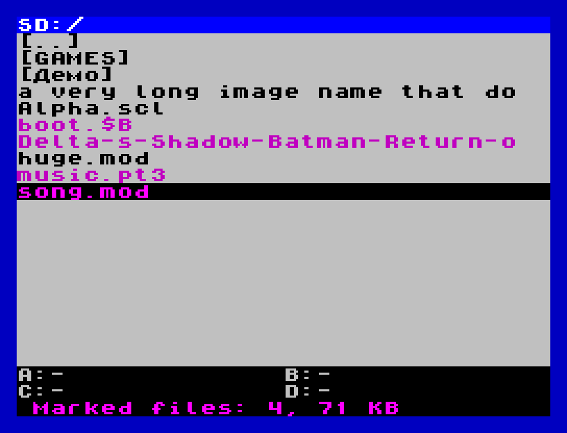
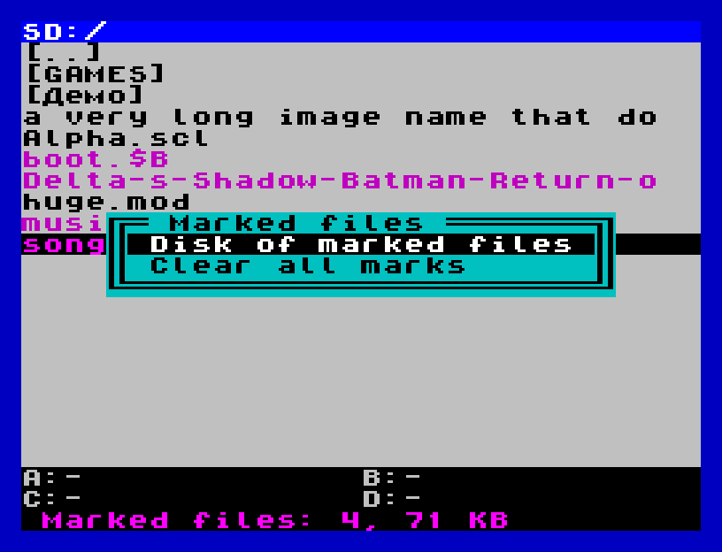

# Работа на Спектруме

Файл для платы выбирает одна из двух программ из `release/`: ugly player
под TR-DOS или плагин Wild Commander. Играют они одинаково, различаются
источником файла и экраном. Образы дисков TR-DOS вставляет меню по NMI.

## Что играет плата

| Формат | Что это |
|---|---|
| MOD, S3M, XM, IT | трекерные модули |
| MID | MIDI-файлы форматов 0 и 1, звучат банком инструментов ([Банки](#банки)) |
| VGM, VGZ | записи музыки чипов, VGZ - сжатый gzip |

Формат плата определяет по содержимому файла, а не по расширению.

Чипы VGM: SN76489, AY8910 и YM2149, YM2203, YM2608, YM2610 и YM2610B,
YM2612 и YM3438, YM2151, YM2413 и VRC7, YM3526, YM3812, Y8950, YMF262,
SAA1099, K051649 (SCC). Партии других чипов в файле молчат.

## Что куда положить

| Файл | Куда |
|---|---|
| `ugly.$c` | в образ диска TR-DOS; файл Hobeta, загружается с адреса 0x6000 |
| `ugly.sna` | на карту; запускается с неё через DivMMC (`DISKSYS=DIVMMC`) |
| `UMPLAYER.WMF` | в каталог `WC` загрузочного носителя Wild Commander, строкой `UMPLAYER.WMF` в раздел `[PLUGINS]` файла `wc.ini` |
| `midi.ssb` | в корень SD-карты платы, если нужен банк с карты |
| `YM2608.ROM` | в корень SD-карты платы: образ ПЗУ YM2608, 8192 байта, для ударных этого чипа в VGM; имя в любом регистре |
| музыка | в любой каталог карты с файловой системой FAT32 |
| образы TRD и SCL | на карту или флешку USB, для меню образов дисков |

## ugly player - TR-DOS

`ugly.$c` - файл Hobeta, записывается в образ TRD. `ugly.sna` - тот же
плеер снимком памяти 128К: ни образа диска, ни загрузчика ему не нужно,
снимок запускает DivMMC прямо с карты. Плата эмулирует DivMMC сама, поэтому
так плеер запускается и на машине без дисковода и без своего интерфейса
карты. Выхода из плеера нет: он работает до сброса машины.

На старте плеер показывает список устройств карты: `ZC` - Z-Controller,
`DIVMMC1` и `DIVMMC2` - две карты DivMMC. `ENTER` открывает устройство; в
его корне первая строка `[..]` и `CS+0` возвращают к списку. Играющий трек
не прерывается, пока вы листаете другое устройство.

### Клавиши

`CS` - CAPS SHIFT. Колонка USB - для клавиатуры USB, подключённой к плате
([config.md](config.md)).

| Спектрум | USB | Что делает |
|---|---|---|
| `ENTER` | `Enter` | играть файл, войти в каталог или устройство |
| `CS+0` | `Backspace` | на уровень выше; в корне устройства - к списку устройств |
| `SPACE` | пробел | следующий трек |
| `P` | `P` | пауза; повторное нажатие - продолжить |
| `F` | `F` | вперёд на 10 секунд |
| `M` | `M` | режим повтора |
| `CS+7`, `CS+6` | вверх, вниз | по списку; удержание повторяет |
| `CS+5`, `CS+8` | влево, вправо | страница назад и вперёд, курсор остаётся в той же строке экрана |

`SPACE`, `P` и `F` действуют, пока на экране каталог играющего трека.

Пауза останавливает трек на месте, статус показывает `PAUSE`. Перемотки
назад нет. Нажатия `F` копятся: два нажатия - 20 секунд. У живого MIDI
перемотки нет.

### Режимы повтора

`M` переключает режимы по кругу, значок режима стоит слева от часов:

1. весь каталог по кругу (при запуске);
2. один трек; `SPACE` всё равно переходит к следующему;
3. случайный порядок без повторов, пока не сыграны все файлы каталога;
4. каталог до конца один раз, потом стоп.

Каталоги в очереди пропускаются. Очередь идёт в каталоге играющего трека.
Если уйти в другой каталог, трек доиграет, а следующий не начнётся. После
возврата очередь продолжается; если трек уже доиграл, следующий начнётся
сразу.

### Экран

Верхняя часть - показания трека, нижняя - список файлов.

| Где | Что показывает |
|---|---|
| слово в левом верхнем углу | `STOP` - ничего не играет, `LOAD` - загрузка, `PLAY`, `PAUSE`, `END` - трек кончился, `ERROR` - файл не принят |
| рядом | формат файла: сначала по расширению, потом по ответу платы |
| часы | позиция и длительность, мм:сс; длительность `00:00` - неизвестна |
| `CPU` | загрузка ядра платы синтезом, проценты; от 90 красным |
| `CH` | число звучащих голосов |
| `L`, `R` | уровень левого и правого канала |
| полосы слева | спектр, 16 полос |
| полоса под часами | сплошная часть - позиция в треке, штриховка - доля загруженных сэмплов |
| строка чипов | у VGM - чипы файла (`2x` - два одинаковых), у трекерного - программа, в которой он записан |
| строка крупными точками | сведения о треке по кругу, см. ниже |
| строка под ней | название пункта; справа - размер файла в КБ или МБ |
| кнопки | `STOP` красная, когда ничего не играет; `PLAY` зелёная при игре, жёлтая при загрузке и паузе; `>>` вспыхивает на `F` и при смене трека; кнопка повтора - на `M` |
| значок слева от кнопок | зелёный - плата отвечает, красный - нет |

Строка сведений показывает пункты по очереди, пустые пропускает. Короткий
пункт стоит 5 секунд, длинный прокручивается до конца.

| Пункт | Что в нём |
|---|---|
| `TITLE` | название |
| `AUTHOR` | автор |
| `GAME`, `SYSTEM`, `DATE` | игра, система и дата, если они есть в файле (у VGM) |
| `PROGRAM` | программа, в которой записан файл |
| `FORMAT` | у `.mid` - число дорожек, PPQ и темп; у трекерных - каналы, скорость, темп и число позиций |
| `FILE` | имя файла и размер в байтах |

Пока ничего не играет, в строке по кругу: `PLAYER` - версия плеера,
`BOARD TYPE` - имя платы или `NO BOARD`, `HOTKEY` - клавиши по одной.

В списке каталоги в квадратных скобках, вперёд, дальше файлы по имени без
учёта регистра. Курсор - белым по синему, играющий трек - чёрным по
жёлтому. Над списком путь; длинный путь показан хвостом с `...` впереди.
Вложенность - до 7 каталогов от корня устройства.

### Сообщения

Сообщение встаёт в строку сведений с пунктом `ERROR`.

| Сообщение | Что значит |
|---|---|
| `no card` | на устройстве нет карты или машина его не видит |
| `no fat32` | на карте нет тома FAT32 |
| `dir read error`, `dir open error`, `no root` | каталог не прочитался |
| `open failed: io` | файл не прочитался |
| `open failed: ovf` | файл записан на карте слишком многими кусками; помогает переписать его на карту заново |
| `file rejected` | плата файл не приняла; плеер переходит к следующему |

## ugly media player - плагин Wild Commander

`UMPLAYER.WMF` для TS-Config. Wild Commander вызывает его на файлах `XM`,
`MOD`, `S3M`, `IT` и `MID`. Файл читает сам WC, плагин выводит окно с
показаниями платы.

| Клавиша | Что делает |
|---|---|
| пробел или вправо | следующий файл панели |
| влево | предыдущий файл панели |
| `Esc` | выход |

Когда трек доиграл, плагин переходит к следующему файлу панели; после
последнего выходит.

| Строка | Что значит |
|---|---|
| Board | имя платы или `not found` |
| File | имя файла |
| State | `starting` - загрузка, `playing`, `finished` |
| Loading / Time | сколько сэмплов загружено из скольких; после загрузки - позиция и длительность |
| Samples / Patterns / Instr | что нашлось в файле |
| Samples loaded / queued / total | сэмплов загружено, в очереди, всего |
| Voices | среднее число звучащих голосов |
| CPU | загрузка ядра синтезом, проценты; от 90 красным |

Восклицательные знаки после числа голосов (до трёх) означают, что
плата снимает голоса из-за перегрузки: чем их больше, тем сильнее
снижена полифония. Часть нот при этом не звучит.

`Board not found - check the bus` - плата не ответила. `Session rejected
by board` - плата файл не приняла.

## Клавиатура USB

Кроме обычных клавиш, у клавиатуры USB есть сочетания для платы и машины:

| Сочетание | Что делает |
|---|---|
| `F11` | NMI машины |
| `F12` | сброс машины, если разрешён настройкой `RESET_SIGNAL` |
| `Ctrl`+`Alt`+`Del` | перезапуск платы; машины тоже, если разрешён `RESET_SIGNAL` |
| `Win`+`F12` | конфигуратор настроек |
| `Win`+`F2` | клавиатура - джойстик Kempston: стрелки, пробел и `Enter` |
| `Win`+`F1` | обычная клавиатура |
| `Win`+`F3` | при `DISKSYS=TRDOS` - поменять местами образы в дисководах A и B, если вставлены оба |
| `F10` | остановить музыку платы, машину не сбрасывая; живой MIDI с машины `F10` не останавливает |

После сброса машины или NMI клавиатура сама становится обычной. Какие
клавиши в режиме `Win`+`F2` становятся джойстиком, задаётся настройками
([config.md](config.md)).

## Меню образов дисков

При `DISKSYS=TRDOS` клавиша `F11` (NMI) открывает меню образов дисков.
Пока оно открыто, весь звук платы молчит, включая звук машины; музыка стоит
на месте и после выхода играет дальше.

Верхний уровень меню: `SD` - карта, `USB` - флешка, `WIFI` (пока
недоступен) и `RECENT` - десять последних вставленных образов. Недоступные
пункты написаны синим, `Enter` на них не действует. Если доступен только
один пункт, меню сразу открывает его. Следующий раз меню открывается в
каталоге, где было в прошлый раз.

Каталоги - в квадратных скобках и вперёд, дальше файлы по имени без учёта
регистра. Скрытые и системные файлы и имена с точкой впереди не
показываются. В верхней строке носитель и путь, внизу - что вставлено в
дисководы A, B, C, D (`-` - пусто).

| Клавиша | Что делает |
|---|---|
| вверх, вниз | по списку |
| влево, вправо | в начало и в конец списка |
| `Enter` | войти в каталог; на образе TRD или SCL - вставить его в дисковод; на файле - сделать из него диск |
| `Backspace` (`CS+0`) или пункт `..` | на уровень выше |
| пробел | отметить файл или снять отметку, курсор переходит ниже; удержанный пробел отмечает файлы подряд |
| `Esc` (`CS+SPACE`) | выход |

Меню закрывается, когда отпущены все клавиши: удержанный `CS+SPACE` -
это BREAK, и TR-DOS прервал бы им дисковую операцию программы.

В выпадающих меню: вверх и вниз - выбор, `Enter` - выполнить, `Esc` или
`Backspace` - отмена.

**Образ в дисковод.** `Enter` на образе TRD или SCL открывает меню
`Insert into drive`: дисковод A, B, C или D, для каждого `read and write`
(записанное на диск попадает в файл образа, подробно - [config.md](config.md))
или `read only` (только чтение). Вставленный образ попадает в `RECENT`.

**Диск из файлов.** Отметьте пробелом нужные файлы: отмеченные пишутся
пурпурным, внизу показано, сколько файлов отмечено и сколько места они
займут на диске. Каталоги, образы и файлы, которые на диск не помещаются,
пробел пропускает; о файле внизу будет написано, почему он не отмечен.
`Enter` на любом файле откроет меню:

- `Disk of marked files` - собрать из отмеченных файлов диск TR-DOS и
  вставить в дисковод, который вы выберете;
- `Clear all marks` - снять все отметки.

На образе в этом меню есть третий пункт, `Insert this image` - вставить
сам образ.

Если ничего не отмечено, `Enter` на файле делает диск из него одного.
После сборки диска отметки снимаются. В строке дисковода такой диск
называется `FILES: n`, где n - число файлов.

Имя файла на диске - первые 8 знаков имени, тип - первая буква расширения:
`music.pt3` станет файлом `music` типа `p`; файл без расширения получает
тип `C`. Файл Hobeta (расширение начинается с `$`) попадает на диск со
своими именем, типом и адресом. Если имя и тип совпали с уже записанным
файлом, конец имени заменяется счётчиком: `Karbofos - Banana.pt3`,
`Karbofos - Cucumber.pt3`, `Karbofos - Tomato.pt3` станут `Karbofos`,
`Karbofo1`, `Karbofo2`; короткое имя получает счётчик за собой: `Bony`,
`Bony1`. Диск только для чтения, файлы на карте не меняются.

Что помещается на диск:

- не больше 128 файлов;
- файл не длиннее 65280 байт (255 секторов) - файл длиннее не отмечается;
- всего до 1020 КБ - когда места нет, новая отметка не ставится.

Пока файлы занимают до 636 КБ, получается обычная дискета на 80 дорожек.
Если больше - дорожек становится больше, до 128, как у дискет на 1 МБ.

Отметки действуют в одном каталоге и снимаются при переходе в другой.

Если диск не собрался, внизу написана причина, а курсор стоит на файле,
который не прочитался.

| Сообщение | Что значит |
|---|---|
| `Too long: over 255 sectors` | файл длиннее 255 секторов, не отмечен |
| `128 files is the limit` | отмечено уже 128 файлов |
| `No room: the disk holds 1 MB` | отмеченные файлы заняли весь диск |
| `This file does not open` | файл не открывается |
| `This file is in too many pieces` | файл записан на карте слишком многими кусками; помогает переписать его на карту заново |
| `Drive busy: disk not made` | дисковод ещё держит прежний образ, диск не собран |
| `Image not inserted` | образ не вставлен |
| `Can not open` | каталог или пункт не открылся |

## Живой MIDI

Файл - не единственный источник. Плата слушает линию MIDI OUT Спектрума
128: это бит 2 порта A звукового сопроцессора, и любая программа,
выдающая MIDI штатным способом, будет слышна без всякой подготовки.
Ни одно из двух приложений для этого не нужно. Работает при
`LIVE_MIDI=HOOK` (по умолчанию, [config.md](config.md)).

Режим включается сам, как только пошёл поток. Играющий файловый трек при
этом снимается - вместе они не звучат. Выключается режим после пяти секунд
тишины, и тогда можно снова запускать файлы. Время в меню NMI и на паузе
в эти пять секунд не входит.

Инструменты берутся из банка во флеше платы, а не с карты.

## Банки

MIDI воспроизводится банком инструментов. Залитый во флеш платы
GeneralUser GS работает сразу - записывать на карту ничего не нужно.

В релизе есть ещё два банка: `SGM.ssb` (36 МБ) и `Timbres-of-Heaven.ssb`
(66 МБ). Чтобы плата играла одним из них, файл копируется **в корень
SD-карты под именем `midi.ssb`** - имя ровно такое. Банк на карте один,
переключаются подменой этого файла. Банк плата берёт при старте: после
подмены файла плату нужно перезапустить.

| Что на карте | Чем играет |
|---|---|
| `midi.ssb` есть | им |
| нет | встроенным GeneralUser |

Что найдено, плата сообщает в журнал при старте. Если банка нет ни на
карте, ни во флеше, трекерные форматы и VGM воспроизводятся как обычно, а
`.mid` отклоняется с указанием причины.

Свой банк из любого `.sf2` - [banks.md](banks.md).
